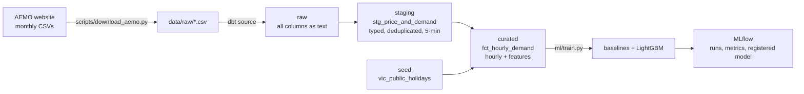

# vic-demand-forecast

Day-ahead hourly electricity demand forecasting for Victoria, built with **dbt**, **DuckDB**, **LightGBM** and **MLflow**.

> **Scope:** this is a learning project built in an evening to get hands-on with dbt and MLflow. It is not production software. The [decision log](DECISIONS.md) explains every choice, the alternatives I considered and why I chose what I did.

## Problem

AEMO and market participants need to know tomorrow's electricity demand to schedule generation. The goal here: **forecast each hour of demand in Victoria using only information available 24 hours earlier**, and measure how much better a model does than simple rules of thumb.

## Results

Test period: August to October 2026 (2,208 hours), scored once after all modelling choices were made.

| Model | Test MAE (MW) | Test MAPE |
|---|---|---|
| Naive: same hour last week | 550 | 11.5% |
| Naive: same hour yesterday | 490 | 10.0% |
| **LightGBM** | **391** | **8.0%** |

LightGBM has **29% lower error** than the same-hour-last-week baseline and 20% lower than same-hour-yesterday, using only lagged demand and calendar features (no weather data yet).

## Architecture



| Layer | What it holds | Materialisation |
|---|---|---|
| **raw** | AEMO's 5-minute CSVs, unchanged, read as text. Declared as a dbt source. | Files on disk |
| **staging** | One row per 5-minute interval: parsed timestamps, numeric columns, deduplicated, with `interval_start` added because AEMO stamps the *end* of each interval. | View |
| **curated** | One row per hour: mean demand (the target), 24-hour and 168-hour lags, rolling means ending 24 hours back, market and local hour, day of week, month, public holiday flag. | Table |

**Data tests (18, all run by `dbt build`):**
- `not_null` and `unique` on every timestamp key
- a custom `within_range` generic test on demand (0 to 14,000 MW) and on intervals per hour (exactly 12)
- a singular test that generates every expected 5-minute interval and fails if any are missing

**Key details:**
- **Market time.** AEMO timestamps are AEST (UTC+10) all year, with no daylight saving. That keeps every day at exactly 24 hours, so the lag features stay simple. A Melbourne local-hour feature is added separately, because people follow the clock on the wall.
- **No leakage.** Every feature uses only data from 24 or more hours before the hour being predicted. Price is excluded, because tomorrow's price isn't known today.
- **Time-based split.** Train: November 2024 to April 2026. Validation: May to July 2026, used only for early stopping. Test: August to October 2026. A random split would leak near-identical neighbouring hours into training.

## How to run

You need Python 3.10 to 3.12 (dbt doesn't support 3.13 or later yet). Everything runs locally; no cloud accounts are needed.

```bash
python -m venv .venv
.venv\Scripts\activate          # Windows (macOS/Linux: source .venv/bin/activate)
pip install -r requirements.txt
python run_pipeline.py
```

`run_pipeline.py` runs three steps and stops at the first failure:

1. `python scripts/download_aemo.py` downloads 24 months of AEMO data to `data/raw/`. It skips files already on disk.
2. `dbt build` loads the holiday seed, builds staging and curated, and runs all tests.
3. `python ml/train.py` scores the baselines, trains LightGBM, and logs everything to MLflow.

To compare runs and see the registered model:

```bash
mlflow ui --backend-store-uri sqlite:///mlflow.db
```

Then open http://localhost:5000 and choose **Model training**.

Other useful dbt commands: `dbt docs generate && dbt docs serve` (browsable docs and a lineage graph), and `dbt test --select fct_hourly_demand` (tests for one model).

## Repo layout

```
scripts/download_aemo.py      extract: AEMO CSVs to data/raw/
scripts/make_holiday_seed.py  generates seeds/vic_public_holidays.csv (run once)
models/raw/sources.yml        raw layer: the CSVs declared as a dbt source
models/staging/               typed, deduplicated 5-minute data + tests
models/curated/               hourly feature table + tests
macros/test_within_range.sql  custom generic test
tests/                        singular test for missing intervals
ml/train.py                   baselines, LightGBM, MLflow logging
run_pipeline.py               runs everything in order
DECISIONS.md                  every decision, the alternatives and why
```

## What I'd do next with more time

- **Weather data.** Temperature drives Victorian demand, especially heating in winter and cooling in summer heatwaves. Adding BOM observations and forecasts is likely the single biggest accuracy gain.
- **Rolling-origin backtesting.** Repeat the train and test split at several cut-off dates, so the result doesn't depend on one three-month test period, which currently has no summer.
- **Orchestration.** Run the steps as an Airflow DAG (download, then `dbt build`, then train) on a daily schedule, with retries and alerting. The idempotent download and fail-loudly tests are already designed for this.
- **Model registry workflow.** Promote a model version to production only if it beats the current one on the latest backtest. Serve it with an alias like `@champion`.
- **Monitoring.** Track live MAE against the naive baseline every day, watch for drift in the input features (for example, rooftop solar growth pushing midday demand down), and retrain automatically when error rises.
- **Incremental models.** Make the dbt models incremental, so each daily run only processes new intervals rather than rebuilding two years of data.
- **Prediction intervals.** Use quantile regression to give a range rather than a single number, which is what operators need for planning reserves.
- **Pin dependency versions** for reproducible installs.

## Data

[AEMO aggregated price and demand data](https://aemo.com.au/energy-systems/electricity/national-electricity-market-nem/data-nem/aggregated-data), region VIC1, November 2024 to October 2026. Raw files aren't committed; the download script fetches them. Public holidays come from the [`holidays`](https://pypi.org/project/holidays/) Python package.
